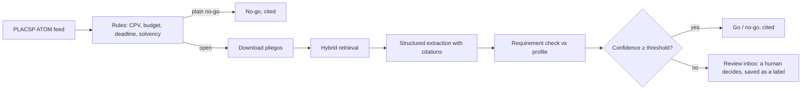

# Licita

> **Learning build, in progress (NNN week 3, 16-22 Nov 2026).** The numbers below are filled in as they are measured; until then they say so.

**Licita reads Spain's public tenders every morning, matches them against a company profile, and gives a go / no-go that cites the exact clause of the tender documents.**

| Measured | Value | Backed by |
|---|---|---|
| Extraction accuracy | _pending_ | ~20 hand-labelled tenders |
| Cascade: precision of auto-accepted decisions / share sent to review | _pending_ | same set |
| Coach gain on the held-out half | _pending_ | held-out labelled tenders |
| Cost per tender analysed | _pending_ | cost ledger |

## How it works

## Design decisions

| Decision | Why |
|---|---|
| _filled in as ADRs land in `docs/adr/`_ | |

## Limits

_Filled in honestly as the week goes: what is not solved or not enforced yet._

## Repo map

- `src/licita/`: pipeline, model-agnostic `LLMClient`, budget guard, tracing
- `web/`: React + TypeScript front
- `data/company/profile.yaml`: the fictional company the tenders are matched against
- `docs/adr/`, `docs/model-research.md`, `FAILURES.md`: decisions, model choice, real failures
